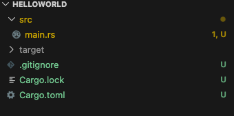
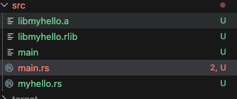

## 创建工程
```rust
cargo new helloworld --bin
```




## 单rust编译为可执行
```rust
fn main() {
    // println!("Hello, world!");
    if cfg!(sayhello){
        println!("Hello Milly!");
    }
}
```

cfg! 指定编译！ 编译指令

```bash
caixian@CXi-Mac helloworld % cd src
caixian@CXi-Mac src % rustc --cfg sayhello main.rs 
caixian@CXi-Mac src % ./main
Hello Milly!
caixian@CXi-Mac src % 
```


## 编译为静态库


```rust
pub fn print_hello()
{
    println!("Hello this is Lib!");
}
```

```rust
extern crate myhello;

fn main() {
    // println!("Hello, world!");
    if cfg!(sayhello){
        println!("Hello Milly!");
    }
    myhello::print_hello();
}
```

```bash
rustc --crate-type lib myhello.rs  # 编译为静态库
rustc -L. -lmyhello main.rs	# 编译为 可执行程序
rustc -L. -lmyhello --cfg sayhello main.rs # 添加标志
```
