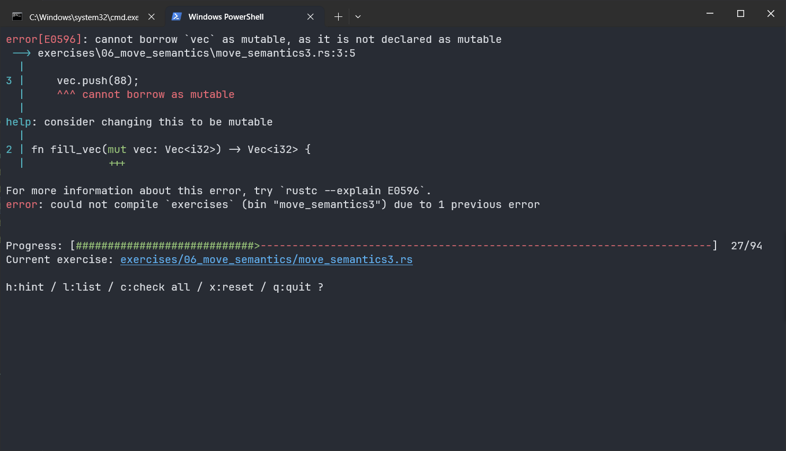
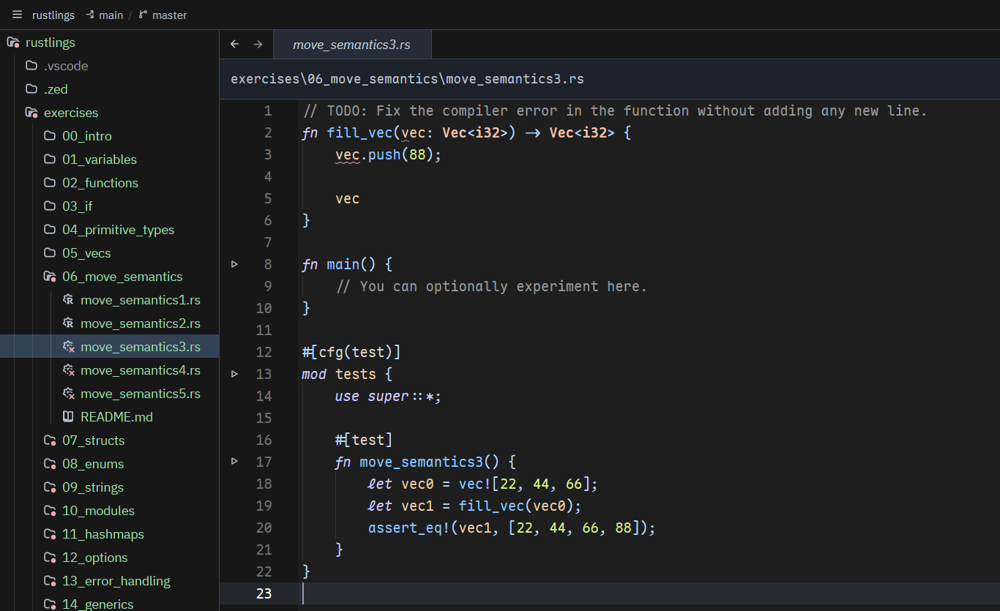
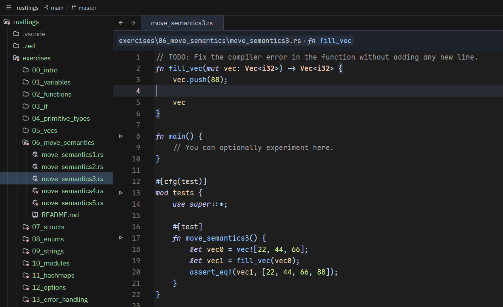
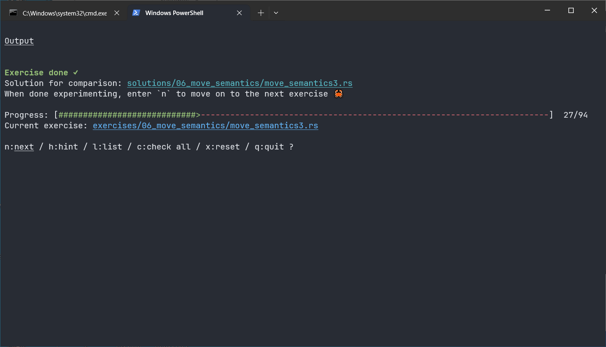

## 这是什么

[rustlings](https://github.com/rust-lang/rustlings) 是 rust-lang 官方组织下的开源入门练习项目，专门用来上手练 Rust。建议配合官方教材阅读，中文读者也可以用 [Rust 程序设计语言中文版](https://kaisery.github.io/trpl-zh-cn/)。

它的核心玩法很直接：

> 每个小题都自带错误、默认编译不过。你读编译器报错、改代码，直到编译或测试通过，再进入下一题。

重点不是“背语法”，而是**习惯看 rustc 的报错**。这是 Rust 学习里最重要的能力之一。

## 能练什么

练习按知识点分组：

- 基础语法：变量、类型、函数、`if`、循环、字符串、数组、`Vec`
- Rust 难点：所有权、借用、生命周期（`move_semantics`）
- 枚举、`Option`、`Result`、错误处理
- 结构体、`trait`、模块、包管理
- 章节小测验，用来复盘

它不教你写大型项目，目标更具体：

1. 熟悉 Rust 语法；
2. 读懂编译器报错；
3. 建立所有权、借用的直觉；
4. 在本地编辑器里写代码，和真实开发环境一致。

## 安装与开始

```shell
cargo install rustlings
rustlings init
cd rustlings
rustlings
```

`rustlings init` 会拉取练习仓库；也可以直接：

```shell
git clone https://github.com/rust-lang/rustlings.git
cd rustlings
rustlings
```

启动后，终端会显示当前题目和错误位置。下面这题提示不能把值借用为可变：



进入代码文件，题目要求是：

> Fix the compiler error in the function without adding any new line.

也就是不加新行，修掉函数里的编译错误。



这里的 `vec` 参数默认不可变，而 `push` 需要可变引用，所以给参数加上 `mut`：



回到终端，看到编译检查通过。整个过程不需要手动 `cargo build`、`cargo run`，也不会不断生成 `target/`，对新手很友好。



## 适合谁

- 刚看完 Rust 基础语法，想动手验证；
- 被所有权、借用卡住，需要大量小题建立直觉；
- 想养成“先读报错再改代码”的习惯。

如果已经能独立写小项目，rustlings 的收益会下降；这时更适合直接做项目、读真实 crate 的源码。

## 参考

- [rust-lang/rustlings](https://github.com/rust-lang/rustlings)
- [Rust 程序设计语言中文版](https://kaisery.github.io/trpl-zh-cn/)
